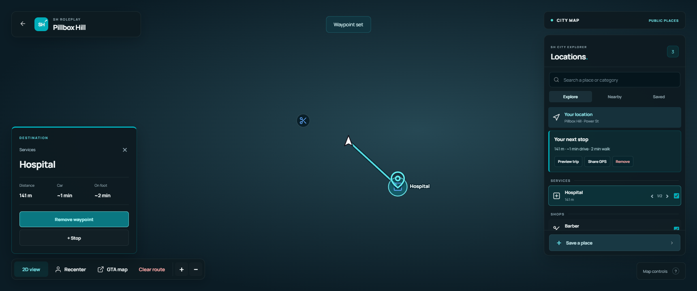

# sh_pauseMenu

A configurable FiveM pause menu with character information, an interactive city map, saved places and quick access to GTA settings.

**Release candidate:** `v1.0.0-rc.5`. See [verification status](TESTING.md) before deploying to a production server.



*UI preview with a neutral test background. FiveM renders the live city scene behind the interface in game.*

## Features

- English interface with transparent game background, adjustable darkness, blur and menu sounds.
- Character name, session/citizen ID, job, cash and bank balance.
- Native character headshot using a local duplicate; the player's real mask and clothing remain untouched.
- Aerial game camera with pan, rotation, bounded zoom and recenter controls.
- 2D map using game textures at runtime; no bundled map engine, road database or sprites from the reference resource.
- Public fixed-location server blips, searchable places, waypoint selection, up to five sequential stops and a GPS route preview.
- Compact SH city explorer: right-side location list, per-type visibility, branch cycling, destination card and teal waypoint pins.
- Up to 30 saved places per character, stored in server resource KVPs.
- GPS sharing with nearby players or coworkers on duty.
- Automatic ESX Legacy, QBCore and Qbox detection, plus standalone and custom adapters.
- No runtime Node.js, Yarn, npm, ox_lib, oxmysql or database dependency.

## Installation

1. Extract the resource as `resources/[local]/sh_pauseMenu`. Keep this folder name and letter casing.
2. Edit `config.lua`, especially the server name, links and rules.
3. Start your framework before this resource. Disable your previous pause menu.

```cfg
# Start only one pause menu.
ensure sh_pauseMenu
```

For an existing running server, run these in the **server console**:

```text
stop teal_pause
stop zx_pause
refresh
ensure sh_pauseMenu
```

`refresh` matters after adding files or changing the resource manifest. Open the menu with **ESC**, **P**, **F10**, or `/pausemenu`. The F10 binding is remappable in FiveM key bindings.

## Configuration

`Config.Framework` accepts `auto`, `esx`, `qb`, `qbox`, `standalone` or `custom`. Configure framework resource names in `Config.Resources`. Standalone mode leaves unavailable balances and jobs blank.

The map imports only coordinate-based blips whose sprite is registered in `Config.MapSprites`. Entity-attached blips, unknown sprites, personal vehicles and unrequested shared trackers are excluded. Add a sprite definition only for public places; set `public = false` to exclude it. Scripts that disguise live trackers as coordinate-based public locations must be corrected at their source. Add additional places or position-based name overrides to `Config.MapLocations`. Customize sprite names and categories in `Config.MapSprites`, saved-place colors in `Config.MapColors`, and camera defaults in `Config.Map`.

Optional integrations are disabled by default. For a ZX server, set:

```lua
Config.Integrations.hudOverlayEvent = 'zx_interface:client:overlay'
Config.Integrations.weatherResyncEvent = 'zx_weather:server:requestSync'
```

Your radial menu or other UI should check the new resource name:

```lua
local pauseOpen = GetResourceState('sh_pauseMenu') == 'started'
    and exports['sh_pauseMenu']:IsOpen()
```

For a custom framework, implement `SHBridge.Custom` in `server/custom.lua`. Keep identity and balances server-authoritative. Saved-place character ownership and coworker sharing currently have built-in adapters for ESX/QB/Qbox; extend the corresponding server functions for a custom framework.

## Client API

```lua
exports['sh_pauseMenu']:Open()
exports['sh_pauseMenu']:Close()
local opened = exports['sh_pauseMenu']:IsOpen()
exports['sh_pauseMenu']:SetEnabled(false)

AddEventHandler('sh_pauseMenu:visibility', function(opened)
    -- Hide or restore your own HUD here.
end)
```

## Map controls

| Input | Action |
| --- | --- |
| Left click | Select a marker or set a waypoint |
| Left drag | Pan |
| Right drag | Rotate the aerial camera |
| Double-click a location row | Set GPS to that location |
| Mouse wheel / + / − | Zoom |
| Up / Down | Select a place group |
| Left / Right | Cycle places within a group |
| Enter | Set GPS to the selected place |
| T | Hide/show the selected place type |
| Delete | Clear the route |
| Escape / Back | Return to the pause menu |
| / | Focus place search |

### Map privacy

The aerial view suppresses all streamed peds, vehicles and objects locally on every rendered frame, including the opening frame. Their network visibility and physical state remain unchanged. The camera cannot zoom closer than 180 world units, tilt above -55 degrees or enter street view; route previews respect these bounds. Closing the map or stopping the resource restores the normal camera and ends frame-local concealment.

These are safeguards for this map UI, not a server anti-cheat. Other resources can still draw their own overlays or publish coordinate trackers. Test with a second player and your server's actual HUD/blip resources before production deployment.

The route comes from GTA's GPS natives. When ordinary waypoint samples are missing, `Config.Map.nativeRouteFallback` enables an on-foot native road preview while the map is open. It uses the game's shared multi-route channel and clears its preview when the destination changes, is removed, or the map closes. Set this option to `false` if a mission/racing resource must keep that channel during map use. Availability and completeness depend on the game having calculated and streamed the route. The UI does not invent a street route when native points are unavailable; the waypoint remains usable and the native GTA map is always accessible. Travel times are estimates. Alternative road-routing modes from the visual reference are not included.

2D textures are read from the player's game installation. Custom radar replacements may need different texture names or grid coordinates. The built-in GTA map remains available if a game build cannot supply these textures. Controller-specific navigation is not included in this independent implementation.

## Development and verification

The distributed JavaScript/CSS runs directly; there is no frontend build step. Do not add a root `package.json`, as FiveM may treat it as a resource build task.

```text
python -m pip install -r requirements-dev.txt
python tests/run.py
```

Browser checks require Playwright installed **outside the resource**. Set `NODE_PATH` to that installation's `node_modules`, then run `node tests/browser.cjs`. `BROWSER_PATH` can point to an installed Chromium/Edge executable.

See [TESTING.md](TESTING.md) for what was and was not verified. See [THIRD_PARTY.md](THIRD_PARTY.md) for asset attribution. The independent application code is MIT licensed; third-party assets retain their own terms.
